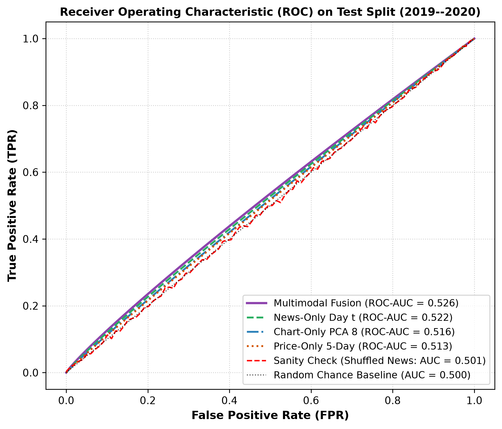
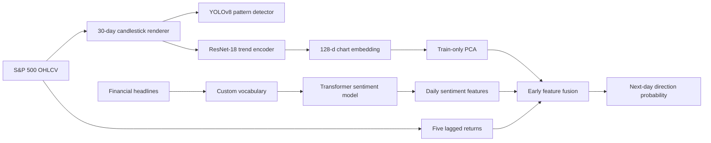

# Multimodal Candlestick Perception and Market-Direction Prediction

> CS 4045 - Deep Learning for Perception, Fall 2026
> Hamza Khurram (`i210735`) and Raja Abdullah Tahir (`i210708`)

[](https://www.python.org/)
[](https://pytorch.org/)
[](#academic-integrity-and-disclosure)

An end-to-end perception project combining candlestick-chart vision and financial-news sentiment. The system detects eight candlestick patterns, predicts next-day direction from chart images, learns financial sentiment without pretrained language models, and evaluates price, news, chart, and fused features under strict temporal splits.



## Key results

| Task | Selected model | Held-out result |
|---|---|---:|
| Candlestick detection | YOLOv8n, chart-safe augmentation | **0.666 mAP@50**, **0.586 mAP@50-95** |
| Chart trend prediction | ResNet-18 | **54.2% accuracy**, **0.539 ROC-AUC** |
| Financial sentiment | Custom Transformer | **66.2% accuracy**, **0.660 Macro-F1** |
| Next-day fusion | Price + news + chart | **58.3% accuracy**, **0.527 ROC-AUC** |

Fusion matched price-only accuracy and improved ROC-AUC from 0.521 to 0.527. Its paired accuracy-difference confidence interval includes zero, so the project treats the incremental lift as statistically inconclusive rather than claiming a reliable market edge.

## System overview



### Leakage controls

- Model selection uses validation data from 2018; 2019-2020 is held out for final testing.
- Both day `t` and target day `t+1` must lie inside the same split.
- Chart PCA is fitted only on 2010-2017 and frozen for validation, test, and recent data.
- News features use headlines dated no later than the permitted prediction day.
- A required day-`t-1` news comparison and 100 headline-date shuffles test timing sensitivity.
- Confidence intervals and paired accuracy differences are bootstrapped on aligned test days.

## Repository layout

```text
.
|-- notebooks/
|   |-- part1_vision.ipynb
|   `-- part2_nlp_fusion.ipynb
|-- checkpoints/
|   |-- yolo_best.pt
|   |-- cnn_trend_best.pt
|   |-- sentiment_best.pt
|   `-- fusion_best.pt
|-- results/                 # Metrics, predictions, embeddings and metadata
|-- report/
|   |-- figures/
|   |-- report.tex
|   `-- report.pdf
|-- scripts/                 # Builders, validators and evaluation-only runners
|-- requirements.txt
`-- README.txt               # Submission-mandated plain-text reproduction guide
```

## Installation

```bash
python -m venv .venv
```

Windows PowerShell:

```powershell
.venv\Scripts\python -m pip install -r requirements.txt
```

Linux/macOS:

```bash
.venv/bin/python -m pip install -r requirements.txt
```

The heavy training notebooks are intended for a Kaggle GPU environment. All experiments use `SEED = 42`.

## Dataset setup

Place the supplied data under `Data/`:

```text
Data/
|-- sp500_stocks.csv
|-- sp500_companies.csv
|-- sp500_headlines_2008_2024.csv
`-- dataset.csv
```

The notebooks also search recursively under `/kaggle/input`. `Data.zip` may be attached as a private Kaggle dataset.

External datasets used:

- *S&P 500 Stocks: 25 Years of Data*
- *Finance News Sentiments* by antobenedetti
- *S&P 500 with Financial News Headlines 2008-2024* by dyutidasmahaptra

## Reproducing the project

### Full training

Run the notebooks from top to bottom in this order:

1. [`notebooks/part1_vision.ipynb`](notebooks/part1_vision.ipynb)
2. [`notebooks/part2_nlp_fusion.ipynb`](notebooks/part2_nlp_fusion.ipynb)

> **Checkpoint warning:** a full run retrains models and can overwrite the supplied checkpoints. Preserve a copy of `checkpoints/` before full reproduction.

### Evaluation from saved checkpoints

Rebuild the leakage-free Part 2 evaluation without retraining the sentiment model:

```bash
python scripts/rebuild_part2_evaluation.py
```

Rerun only the six Transformer hyperparameter experiments, including measured training time, without overwriting `sentiment_best.pt`:

```bash
python scripts/run_sentiment_ablation.py
```

Regenerate the chart splits and export the missing Part 1 YOLO evaluation evidence without retraining or overwriting `yolo_best.pt`:

```bash
python scripts/run_part1_checkpoint_evaluation.py
```

This produces `results/part1_checkpoint_evaluation.zip` for convenient transfer from Kaggle.

Build and validate the final submission archive:

```bash
python scripts/build_submission_zip.py
```

## Evaluation artifacts

- [`results/detection_results.csv`](results/detection_results.csv): YOLO Runs A/B/C aggregate comparison.
- [`results/detection_per_class.csv`](results/detection_per_class.csv): checkpoint precision, recall, AP and box counts for all eight classes.
- [`results/detection_theme_results.csv`](results/detection_theme_results.csv): light, dark, blue-white and recent-set mAP@50.
- [`results/detection_robustness.csv`](results/detection_robustness.csv): 480-pixel/JPEG stress-test degradation.
- [`results/detection_efficiency.csv`](results/detection_efficiency.csv): measured Tesla T4 latency and checkpoint size.
- [`results/trend_results.csv`](results/trend_results.csv): majority, price-logistic and ResNet-18 trend results.
- [`results/sentiment_results.csv`](results/sentiment_results.csv): majority, RNN, BiLSTM and Transformer results.
- [`results/hyperparameter_log.csv`](results/hyperparameter_log.csv): six timed Transformer ablations.
- [`results/market_results.csv`](results/market_results.csv): single-source, lagged-news and fusion metrics with confidence intervals.
- [`results/market_test_predictions.csv`](results/market_test_predictions.csv): reproducible held-out probabilities.
- [`results/headline_shuffle_results.csv`](results/headline_shuffle_results.csv): 100-repeat timing sanity check.
- [`results/chart_embeddings.npy`](results/chart_embeddings.npy) and [`results/embedding_index.csv`](results/embedding_index.csv): dated 128-dimensional chart embeddings.

## Evidence status

Part 1 now includes machine-readable aggregate, class-wise, theme, recent, robustness and efficiency evidence from the supplied YOLO checkpoint. Part 2 includes metrics, confidence intervals, held-out predictions, shuffle results and timed Transformer ablations. Original Kaggle logs remain the authoritative source for the training time and per-epoch histories of YOLO Runs A and B.

## Contributions

| Member | Main contributions |
|---|---|
| Hamza Khurram (`i210735`) | Ticker audit, chart renderer, YOLO experiments, Transformer architecture, multimodal assembly, shuffling validation, report integration |
| Raja Abdullah Tahir (`i210708`) | Pattern-box rules, return EDA, ResNet-18 trend model, grouped bootstrap evaluation, embeddings, NLP preprocessing, baselines and ablations |

Both members contributed across Part 1, Part 2, evaluation and reporting. The detailed contribution matrix is preserved in [`README.txt`](README.txt).

## Academic integrity and disclosure

- YOLO was initialized from `yolov8n.yaml` and trained from scratch; pretrained detection weights were not used.
- The sentiment models use learned embeddings and no pretrained Transformer or language model.
- PyTorch, Ultralytics, scikit-learn, pandas, NumPy, Matplotlib and PIL were used as disclosed libraries.
- AI assistants were used for code structuring, refactoring, report formatting and reproducibility tooling. Model design decisions, training runs and empirical evaluation were executed and verified by the group members.

## Report

The compiled paper, appendices and qualitative galleries are available in [`report/report.pdf`](report/report.pdf).
